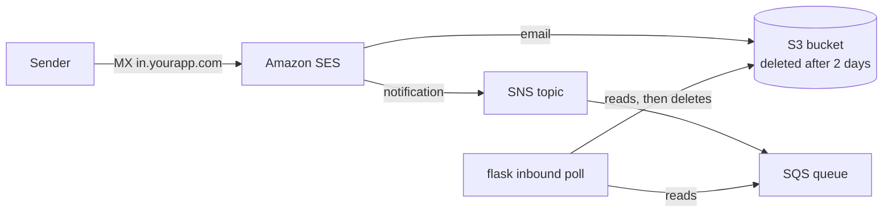

# flask-inbound-email

[](https://github.com/enjinia/flask-inbound-email/actions/workflows/ci.yml)
[](https://pypi.org/project/flask-inbound-email/)
[](LICENSE)

**Give every user of your Flask app their own email address.** What they send or forward there
reaches your app already read: their note, the forwarded message, PDFs and photos, calendar invites.

```
alice-x7k2m9p4q1@in.yourapp.com
```

Users forward an invoice, a booking or a meeting invitation; your app gets:

```python
email.forward.note             # "Pay by Friday"   (what the user wrote on top)
email.forward.original_from    # "Bob Builder <bob@builder.example>"
email.forward.original_subject # "Invoice 42"      (no "Fwd:", "R:", "I:")
email.forward.body             # the forwarded message, without the forward headers
email.files                    # PDFs as they are, photos as JPEGs the right way up
email.skipped                  # what could not be used, and why ("report.docx": unsupported)
email.invite                   # summary, day and time in the user's time zone, video link
```

It was taken out of a production app, where it reads the emails forwarded to a task manager.

## What it takes care of

- **Forwarded emails** from Gmail, Apple Mail and Outlook (desktop, web, and the bare
  "From/Sent/Subject" header block), in English and Italian, also when quoted with `>`.
- **Attachments**: signature logos and icons are ignored, phone photos are rotated and scaled
  down, broken or oversized files are reported with a reason you can tell the sender.
- **Calendar invites** (`.ics`): new, moved (`SEQUENCE`) and cancelled events, all-day events,
  Google Meet / Zoom / Teams links.
- **Trust**: only the user's own addresses may write to them; SPF, DKIM, DMARC, spam and virus
  verdicts are checked; auto-replies, mailing lists and bounces are dropped.
- **Never answering who is rejected**: no mail loops, and no way to find out whether an address exists.
- **Delivery on Amazon SES** with no public webhook: SES stores the email in S3 and notifies a
  queue that your app reads. Works the same on a laptop and in production.

## Install

```sh
pip install flask-inbound-email          # the Flask extension and the email reader
pip install 'flask-inbound-email[aws]'   # plus boto3, to receive through Amazon SES
```

Python 3.10+, Flask 2.3+.

## Use it

```python
from flask_inbound_email import InboundEmail, Result, TemporaryFailure, new_token

app.config["INBOUND_DOMAIN"] = "in.yourapp.com"
inbound = InboundEmail(app)

@inbound.user_loader
def load_user(token):
    # The part before @. Return None for unknown or suspended users.
    return User.query.filter_by(inbound_token=token, active=True).first()

@inbound.trusted_senders
def trusted_senders(user):
    # Only these addresses may write to the user's address. Verify extra ones with a link first.
    return [user.email, *user.verified_emails]

@inbound.handler
def handle(user, email):
    if Note.query.filter_by(message_id=email.message_id).first():
        return Result("ignored", "already received")  # the same email can arrive twice
    try:
        db.session.add(Note(user=user, text=email.forward.note, message_id=email.message_id))
        db.session.commit()
    except OperationalError as e:
        db.session.rollback()
        raise TemporaryFailure() from e  # the email stays in the queue and comes back later
    return Result("handled")
```

Give each user an address once, and show it to them:

```python
user.inbound_token = new_token(user.email)   # "alice-x7k2m9p4q1"; a new one turns the old address off
inbound.address_for(user.inbound_token)      # "alice-x7k2m9p4q1@in.yourapp.com"
```

Then receive what is waiting, every minute or two (cron, a systemd timer):

```sh
flask inbound poll
```

To try emails on your machine, without AWS:

```sh
flask inbound read forwarded.eml --to alice-x7k2m9p4q1@in.yourapp.com
```

A complete app in one file is in [`examples/app.py`](examples/app.py).

### Optional callbacks

| Callback | Called with | Use it to |
|---|---|---|
| `@inbound.notifier` | `user, email, result` | answer the sender ("Done: 1 task added"). Never called for rejected emails; its errors are only logged. Send it with the header `Auto-Submitted: auto-replied`. |
| `@inbound.recorder` | `user or None, sender, subject, result` | keep a log of every email, rejected ones included. Keep it short (e.g. 30 days). |
| `@inbound.user_context` | `user` → context manager | run the handler and the notifier in the user's language, e.g. Flask-Babel's `force_locale`. |
| `@inbound.user_timezone` | `user` → zone name or `tzinfo` | read invites in the user's time zone (default: `INBOUND_TIMEZONE`). |

The extension owns no database table and does not commit anything: your callbacks do.

### Without Flask

The reading part works on its own:

```python
from zoneinfo import ZoneInfo
from flask_inbound_email import Limits, Verdicts, read_email, rejection

email = read_email(raw_bytes, tz=ZoneInfo("Europe/Rome"), limits=Limits(max_files=3))
reason = rejection(email.message, email.sender, Verdicts(spf="PASS", dkim="PASS"), own_domains=["in.yourapp.com"])
```

## Configuration

| Setting | Default | |
|---|---|---|
| `INBOUND_DOMAIN` | — | The domain of the users' addresses, e.g. `in.yourapp.com`. |
| `INBOUND_LEGACY_DOMAINS` | `[]` | Older domains still accepted after a move. |
| `INBOUND_TIMEZONE` | `UTC` | Time zone for invites when `user_timezone` gives none. |
| `INBOUND_QUEUE_URL` | — | The SQS queue (written by the setup command). |
| `INBOUND_AWS_REGION` | `eu-west-1` | The SES region that receives the emails. |
| `INBOUND_AWS_ACCESS_KEY_ID`, `INBOUND_AWS_SECRET_ACCESS_KEY` | — | The app's read-only key. Without them boto3 looks for credentials as usual (environment, `~/.aws`, instance role). |

Attachment limits are set with `InboundEmail(app, limits=Limits(...))`: at most 5 files, PDFs up to
10 MB, pictures under 30 KB ignored, pictures scaled to 2000 px.

## Amazon SES setup



Run once, with **admin** credentials (not the app's):

```sh
AWS_PROFILE=admin inbound-email-aws-setup --app yourapp --domain in.yourapp.com --env-file .env
```

It creates the bucket, the topic, the queue, the SES receipt rule and an IAM user for the app
that can only read the queue and read or delete the stored emails. It writes the `INBOUND_*`
settings into `.env` (the secret key is never printed) and prints two DNS records to add:
an `MX` record for the domain and a `TXT` record that proves it is yours. Running it again
skips what already exists.

Good to know:

- SES receives email only in [some regions](https://docs.aws.amazon.com/ses/latest/dg/regions.html#region-receive-email).
- A region has a single active receipt rule set: if another app already has one, the rule is added to it.
- Use a subdomain (`in.yourapp.com`) so the MX record does not touch your main mailboxes.

The setup command is tested against [moto](https://github.com/getmoto/moto)'s simulated AWS.

## Privacy

The email is deleted from S3 as soon as it is processed (and after 2 days in any case). What you
keep is up to your handler: keep what the feature needs, not the whole email. Forwarded emails
contain other people's data.

## Contributing

Bug reports and pull requests are welcome: see [CONTRIBUTING.md](CONTRIBUTING.md). To report a
security issue, see [SECURITY.md](SECURITY.md).

## License

[Apache-2.0](LICENSE). Made by [Enjinia](https://www.enjinia.it).
